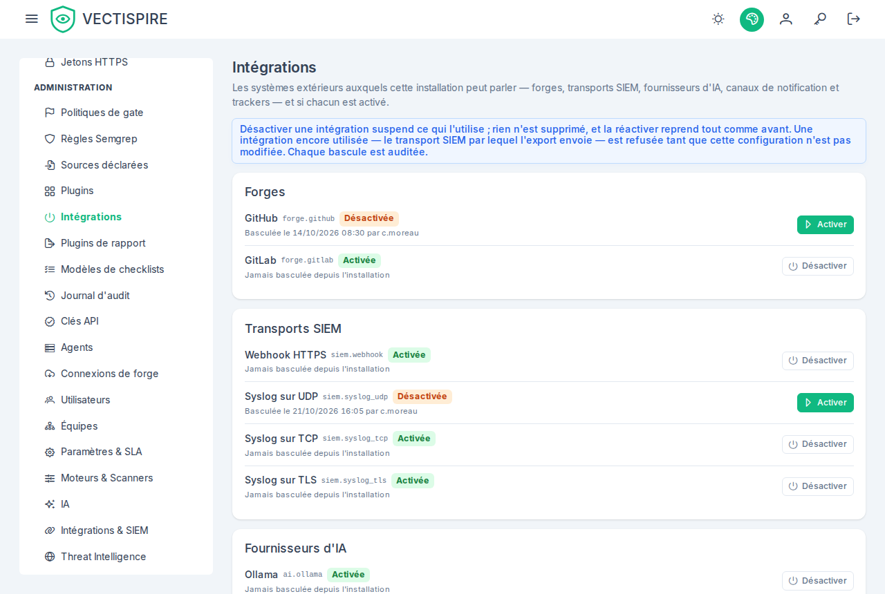

# Intégrations

*Administration → Intégrations* liste les systèmes extérieurs auxquels cette installation peut parler, et si
chacun est activé : les forges, les transports SIEM, les fournisseurs d'IA, les canaux de notification et
les trackers ([décision 0040](https://github.com/asmolabs/vectispire/blob/main/docs/architecture/fr/decisions/0040-integrations-are-switched-on-not-installed.md)).
Une installation qui parle à GitLab et jamais à GitHub, ou qui envoie ses événements de sécurité en syslog
TLS et jamais par un webhook, le dit une fois, ici.

## Qui le voit, qui bascule

**Tous les comptes le lisent** : les formulaires de l'interface filtrent ce qu'ils proposent avec lui, la
liste n'a donc rien de secret. Il est dans la section Administration du menu pour les comptes qui voient
cette section ; les autres l'atteignent par le lien d'une configuration suspendue.

**Seul le gouverneur de la plateforme bascule.** Ce compte voit un bouton *Désactiver* ou *Activer* sur
chaque ligne ; tout autre compte voit l'état et la dernière modification, et aucun bouton. La dernière
modification dit quand, et par qui aux comptes qui ont un rôle de gouvernance (administrateur, RSSI,
auditeur et le gouverneur) ; aux autres elle dit seulement quand, comme l'API (`updatedBy` est `null`
pour eux).

## Les lignes

Chaque intégration montre son nom, sa clé — le `<famille>.<nom>` qu'emploient l'API, le journal d'audit et
les refus, comme `forge.gitlab` —, son état, *Activée* ou *Désactivée*, et sa dernière modification, ou
*Jamais basculée depuis l'installation*. Elles sont groupées par famille, dans cet ordre :

| Famille | Clés |
|---|---|
| Forges | `forge.github`, `forge.gitlab` |
| Transports SIEM | `siem.webhook`, `siem.syslog_udp`, `siem.syslog_tcp`, `siem.syslog_tls` |
| Fournisseurs d'IA | `ai.ollama`, `ai.openai` |
| Canaux de notification | `notification.webhook`, `.teams`, `.slack`, `.discord`, `.mail` |
| Trackers | `tracker.gitlab`, `.github`, `.jira`, `.servicenow` |

Toutes sont activées après une mise à jour ou une nouvelle installation : le registre ne change rien tant
qu'un gouverneur n'agit pas. Une intégration ajoutée par une version ultérieure — Bitbucket d'abord —
arrive désactivée, et est listée telle que le serveur la nomme.

## Désactiver demande d'abord

*Désactiver* ouvre une confirmation qui dit ce qui s'arrête, famille par famille, et que **rien n'est
supprimé : la réactiver reprend tout comme avant**. Rien n'est envoyé avant qu'elle soit acceptée.

- **Une forge** : ses connexions sont suspendues — aucune découverte, aucun import, aucun nouveau jeton ni
  aucune lecture de revue des changements ne passe par elles — et gardent leurs jetons, leurs instantanés
  et leurs liens d'import ; une nouvelle connexion de ce type est refusée
  ([connexions de forge](forge-connections.fr.md#quand-lintegration-de-la-forge-est-desactivee)).
- **Un transport SIEM** : l'export ne peut plus envoyer par lui. Celui qu'utilise l'export activé est
  refusé (ci-dessous) ; les événements destinés à un transport désactivé malgré tout attendent dans
  l'outbox ([SIEM](../integrations/siem.fr.md#chaque-transport-est-une-integration)).
- **Un fournisseur d'IA** : les fonctions qui le lisent disent l'IA indisponible plutôt que d'interroger
  un autre fournisseur.
- **Un canal de notification** : il n'envoie plus rien ; celui qu'une configuration utilise est refusé.
- **Un tracker** : aucun ticket n'est ouvert, fermé ni synchronisé, et ses livraisons de webhook sont
  ignorées ; le jeton, les réglages et les liens entre vulnérabilités et tickets sont gardés
  ([tickets](../integrations/ticketing.fr.md#tracker-suspended)).

*Activer* ne demande rien : cela ne fait que reprendre. Chaque bascule est auditée
`INTEGRATION_ENABLED_CHANGED` et envoyée au SIEM en `VECTI-SEC-019` ([journal d'audit](audit-log.fr.md)).

## Quand une bascule est refusée

Un refus s'affiche sur la ligne de l'intégration qu'il nomme, sous la forme *GitLab n'a pas été
désactivée :* suivie de la raison, dans la langue de l'interface. Rien n'est modifié et rien n'est
enregistré :

| Cause | Quand | Que faire |
|---|---|---|
| `integration-in-use` | L'intégration est encore utilisée — le transport SIEM par lequel l'export activé envoie. | Modifier d'abord cette configuration : diriger l'export vers un autre transport, ou le désactiver, dans les [réglages SIEM](../integrations/siem.fr.md) ; puis la désactiver ici. |
| `integration-not-switchable` | Un fournisseur d'IA ou un canal de notification, dans cette version : leurs adaptateurs ne consultent pas encore le registre, la bascule n'arrêterait donc rien. | Désactiver la revue par IA dans les [réglages](settings.fr.md#revue-par-ia), ou vider l'adresse d'un canal dans les réglages des notifications. En activer un est accepté. |

Une cause que cette version ne connaît pas s'affiche dans les mots du serveur. Les causes sont celles de
[la référence de l'API](../reference/errors.fr.md#causes-dun-409).

## Ce que proposent les formulaires

Partout où un formulaire propose l'une de ces intégrations, une intégration désactivée **n'est pas
proposée pour un nouveau choix**, et une configuration qui en utilise déjà une **se lit suspendue**, avec
un lien vers cet écran :

- **Connexions de forge** : le type de forge d'une nouvelle connexion ne liste que les forges activées —
  les deux désactivées, le formulaire le dit et ne crée rien — et une connexion d'une forge désactivée se
  lit *Suspendue — intégration désactivée*, avec ce que cela veut dire et le lien.
- **SIEM** (réglages, *Intégrations & SIEM*) : la liste des protocoles propose les transports activés ;
  celui qui est enregistré y reste marqué *suspendu*, et la carte dit que ses événements attendent dans
  l'outbox.
- **Tracker** (réglages, *Intégrations & SIEM*) : le fournisseur est une liste — *Aucun* et les trackers
  activés ; celui qui est configuré y reste, marqué *suspendu*, et la carte du tracker se lit *Suspendu —
  intégration désactivée*.
- **Fournisseur d'IA** (réglages, *IA*) : la liste propose les fournisseurs activés ; celui qui est
  configuré y reste, marqué *suspendu*.
- **Canaux de notification** (réglages, *Intégrations & SIEM*, et *Notifications*) : l'adresse d'un canal
  désactivé que personne n'a configuré ne peut pas être saisie ; celle d'un canal déjà configuré reste
  modifiable — la vider est ce qui le libère — et se lit suspendue. La page des notifications l'étiquette
  *Suspendu* et ne propose aucun test.

Le serveur décide malgré tout : un formulaire qui n'a pas pu lire le registre propose tout, et une
intégration désactivée est alors refusée en 409 `integration-disabled`, en la nommant.
