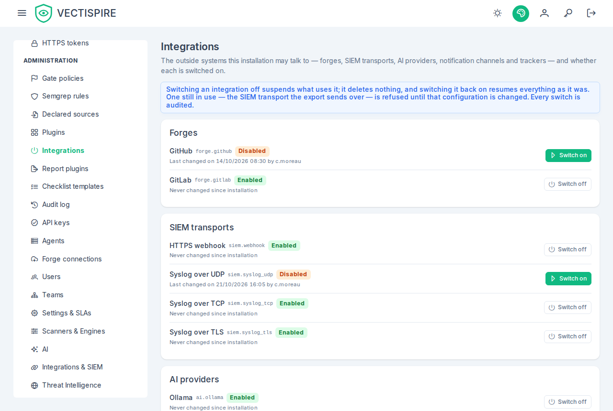

# Integrations

*Administration → Integrations* lists the outside systems this installation may talk to, and whether each
is switched on: the forges, the SIEM transports, the AI providers, the notification channels and the
trackers ([decision 0040](https://github.com/asmolabs/vectispire/blob/main/docs/architecture/en/decisions/0040-integrations-are-switched-on-not-installed.md)).
An installation that talks to GitLab and never to GitHub, or that sends its security events over syslog
TLS and never over a webhook, says so once, here.

## Who sees it, who switches

**Every account reads it**: the forms of the interface filter what they offer with it, so the list is no
secret. It is in the Administration section of the sidebar for the accounts that see that section; the
others reach it through a link from a suspended configuration.

**The platform governor alone switches.** That account sees a *Switch off* or *Switch on* button on every
row; every other account sees the state and the last change, and no button. The last change says when, and
by whom to the accounts with a governance role (administrator, CISO, auditor and the governor); to the
others it says when only, as the API does (`updatedBy` is `null` for them).

## The rows

Each integration shows its name, its key — the `<family>.<name>` the API, the audit log and the
refusals use, such as `forge.gitlab` — its state, *Enabled* or *Disabled*, and its last change, or
*Never changed since installation*. They are grouped by family, in this order:

| Family | Keys |
|---|---|
| Forges | `forge.github`, `forge.gitlab` |
| SIEM transports | `siem.webhook`, `siem.syslog_udp`, `siem.syslog_tcp`, `siem.syslog_tls` |
| AI providers | `ai.ollama`, `ai.openai` |
| Notification channels | `notification.webhook`, `.teams`, `.slack`, `.discord`, `.mail` |
| Trackers | `tracker.gitlab`, `.github`, `.jira`, `.servicenow` |

Every one of them is enabled after an upgrade or a new installation: the registry changes nothing until a
governor acts. An integration a later version adds — Bitbucket first — arrives disabled, and is listed as
the server names it.

## Switching off asks first

*Switch off* opens a confirmation that says what stops, family by family, and that **nothing is deleted:
switching it back on resumes everything as it was**. Nothing is sent until it is accepted.

- **A forge**: its connections are suspended — no discovery, import, new token or change-review reading
  goes through them — and keep their tokens, snapshots and import links; a new connection of that kind is
  refused ([forge connections](forge-connections.md#when-the-forges-integration-is-disabled)).
- **A SIEM transport**: the export can no longer send over it. The one the enabled export uses is refused
  (below); events meant for one switched off all the same wait in the outbox
  ([SIEM](../integrations/siem.md#each-transport-is-an-integration)).
- **An AI provider**: the features that read it say the AI is unavailable rather than asking another
  provider.
- **A notification channel**: it sends nothing; one a configuration uses is refused.
- **A tracker**: no ticket is opened, closed or synchronised, and its webhook deliveries are ignored; the
  token, the settings and the links between issues and tickets are kept
  ([tickets](../integrations/ticketing.md#tracker-suspended)).

*Switch on* does not ask: it only resumes. Each switch is audited as `INTEGRATION_ENABLED_CHANGED` and sent
to the SIEM as `VECTI-SEC-019` ([audit log](audit-log.md)).

## When a switch is refused

A refusal is shown on the row of the integration it names, as *GitLab was not switched off:* followed by
the reason, in the interface's language. Nothing is changed and nothing is recorded:

| Cause | When | What to do |
|---|---|---|
| `integration-in-use` | The integration is still in use — the SIEM transport the enabled export sends over. | Change that configuration first: point the export at another transport, or switch it off, in the [SIEM settings](../integrations/siem.md); then switch it off here. |
| `integration-not-switchable` | An AI provider or a notification channel, in this version: their adapters do not consult the registry yet, so the switch would stop nothing. | Turn the AI review off in the [settings](settings.md#ai-review), or empty a channel's address in the notification settings. Switching one on is accepted. |

A cause this version does not know is shown in the server's words. The causes are those of
[the API reference](../reference/errors.md#409-causes).

## What the forms offer

Wherever a form offers one of these integrations, a disabled one is **not offered for a new choice**, and
a configuration already on one **reads suspended**, with a link to this screen:

- **Forge connections**: the forge kind of a new connection lists the enabled forges only — with both off,
  the form says so and creates nothing — and a connection of a disabled forge reads *Suspended —
  integration disabled*, with what that means and the link.
- **SIEM** (settings, *Integrations & SIEM*): the protocol list offers the enabled transports; the one
  stored stays in it marked *suspended*, and the card says its events wait in the outbox.
- **Tracker** (settings, *Integrations & SIEM*): the provider is a list — *None* and the enabled trackers;
  the one configured stays, marked *suspended*, and the tracker card reads *Suspended — integration
  disabled*.
- **AI provider** (settings, *AI*): the provider list offers the enabled providers; the one configured
  stays, marked *suspended*.
- **Notification channels** (settings, *Integrations & SIEM*, and *Notifications*): the address of a
  disabled channel nobody configured cannot be filled in; one already configured stays editable — emptying
  it is how it is released — and reads suspended. The notifications page tags it *Suspended* and offers no
  test.

The server decides all the same: a form that could not read the registry offers everything, and a disabled
integration is then refused with 409 `integration-disabled`, naming it.
