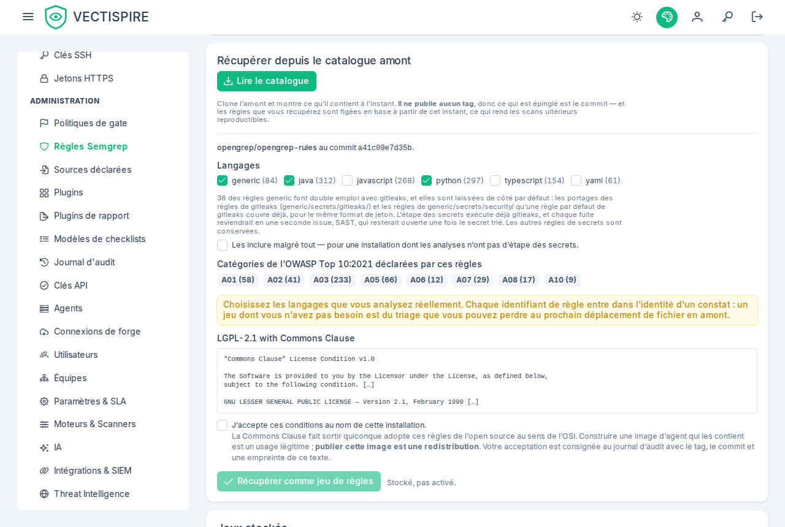
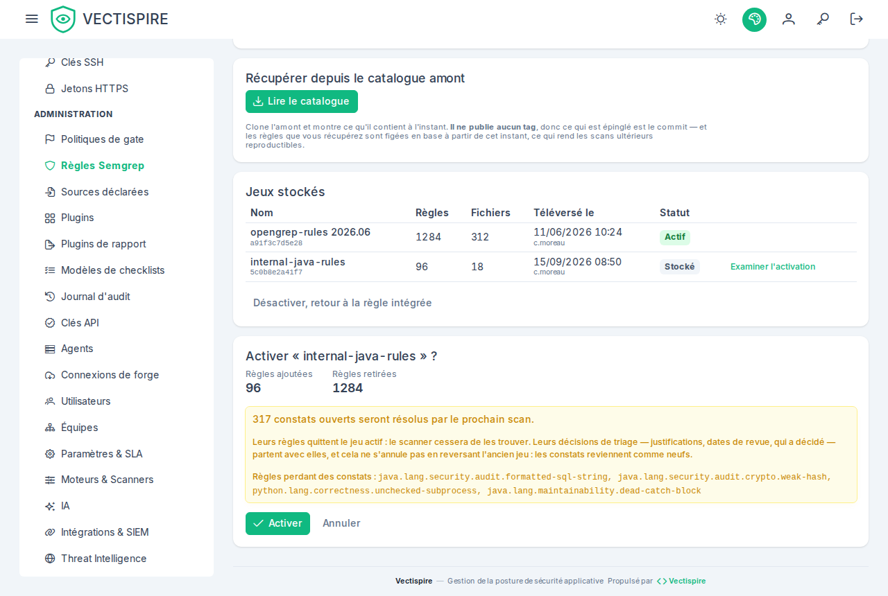

# Jeux de règles Semgrep

Semgrep lit le code source lui-même — une requête SQL concaténée, une commande passée à un
shell, un certificat TLS non vérifié. Aucun autre scanner ici ne voit quoi que ce soit de tout
cela.

Il est **désactivé par défaut**, et s'exécute réseau désactivé comme tous les autres scanners.

!!! info "Qui lit, qui modifie"
    Lire les jeux de règles et leur impact est ouvert aux administrateurs, au CISO et au rôle
    **Auditeur**. Téléverser un jeu, en activer ou en désactiver un demande un administrateur ou
    le CISO.

## Pourquoi vous devez installer les règles vous-même

**Vectispire n'embarque qu'une seule règle.**

C'est une contrainte de licence, pas un oubli : les jeux de règles Semgrep publics ne sont pas
redistribuables. Les livrer placerait un problème de redistribution dans chaque déploiement de
ce produit.

La couverture réelle vient donc d'un jeu de règles que vous installez. Activer Semgrep sans
jeu de règles vous donne les constats d'une seule règle et un faux sentiment de couverture — ce
qui est pire que de le laisser désactivé.

## En installer un

Procurez-vous un jeu de règles sous une licence qui autorise votre usage, et enregistrez-le
dans **Jeux de règles**. Le registre de Semgrep, les règles internes de votre organisation, ou
celles d'un éditeur — la contrainte porte sur la redistribution par Vectispire, pas sur votre
exécution.

### Depuis le catalogue amont

**Récupérer depuis le catalogue amont** clone `opengrep/opengrep-rules`, affiche sa licence et le nombre
de fichiers de règles de chaque langage, et stocke les langages choisis comme un jeu — non activé.
Choisissez les langages que vous analysez : chaque identifiant de règle entre dans l'identité d'une issue.

**Les règles qui font double emploi avec gitleaks sont laissées de côté par défaut.** L'étape des
secrets exécute gitleaks avec ses règles par défaut — la configuration gitleaks de Vectispire les
étend — et `generic` contient deux groupes de règles qui cherchent la même chose :

- `generic/secrets/gitleaks/`, quelque 175 règles portées de gitleaks lui-même ;
- 27 des 50 règles de `generic/secrets/security/`, chacune cherchant un format de jeton qu'une règle
  par défaut dédiée de gitleaks (v8.30.1, la version qu'exécute l'étape des secrets) trouve déjà : les
  identifiants de clé d'accès AWS, Artifactory, Facebook, GitHub, les clés d'API Google et Google Maps,
  Heroku, les JWT, Mailchimp, Mailgun, Picatic, les clés privées PGP et autres, SendGrid, les jetons et
  webhooks Slack, Snyk, SonarQube, Square, Stripe, Telegram et Twilio, ainsi que les règles de clé d'API
  et de secret génériques.

Importées aussi, chaque clé divulguée serait trouvée deux fois : une issue *secret* et une issue *SAST*,
deux issues puisque le type fait partie de l'identité d'une issue. Trier le secret laisserait sa jumelle
SAST ouverte, où elle peut encore faire échouer la barrière, peser sur le score et compter sa catégorie
OWASP une seconde fois. L'écran dit combien il en laisse de côté dès que `generic` est choisi, et
**Les inclure malgré tout** fait entrer les deux groupes — pour une installation dont les analyses n'ont
pas d'étape des secrets. Les 23 autres règles de `generic/secrets/security/` demeurent, parce que les
règles par défaut de gitleaks ne cherchent pas ce qu'elles cherchent : une empreinte bcrypt, une ligne de
`/etc/shadow`, un nom d'utilisateur et un mot de passe dans une URI, une clé d'accès secrète ou un jeton
de session AWS, un `_authToken` dans un `.npmrc`, un jeton d'accès OAuth Google…

Un jeu importé avant la 0.11.0 avec `generic` garde ces règles jusqu'au prochain import. Activer le
nouveau jeu est alors gardé comme toute activation : leurs issues ouvertes sont comptées, règle par
règle, avant que le bouton n'aboutisse.

Pour un script : `POST /api/v1/rule-sets/catalogue` accepte `includeGitleaksDuplicates` (`false` en son
absence), et le `gitleaksDuplicates` de l'aperçu est le nombre concerné, les deux groupes ensemble. Un
jeu qui les contient est nommé `… with gitleaks duplicates`.

## Catégories OWASP {#owasp-categories}

Une règle place ses constats dans la [grille OWASP](../guide/risk-analysis.md#surface-dattaque-et-owasp)
par la catégorie qu'elle déclare dans son propre `metadata.owasp`, et seule une catégorie de
l'**édition 2021** compte (`A03:2021 - Injection`) — l'édition que garde la 1.0 ([conformité](../guide/compliance.md#owasp-edition)).
Les éditions partagent leurs lettres et pas leur sens (`A01:2017` est l'injection, `A01:2021` le
contrôle d'accès défaillant) : une autre édition n'est jamais convertie.

Une règle qui ne déclare aucune catégorie de l'édition 2021 est rangée par la CWE qu'elle déclare dans
`metadata.cwe`, selon les listes OWASP 2021 ([Analyse de risque](../guide/risk-analysis.md#surface-dattaque-et-owasp)).
Une règle étiquetée **seulement** avec une autre édition — `A01:2025` seule, ou `A1:2017` seule — et sans
une telle CWE s'exécute toujours et ses constats arrivent dans le backlog, mais la grille n'en place aucun. L'écran des
jeux de règles le dit : *N fichiers de règles ne déclarent qu'une édition de l'OWASP Top 10 autre que
2021*, avec le compte par édition. Ajoutez la catégorie 2021 à côté de l'autre dans le `metadata.owasp`
de la règle.

Pour un script, `GET /api/v1/rule-sets/coverage` porte le même compte sous `owasp` : `ruleFiles` lus,
`tagged` (qui déclarent une catégorie 2021), `byCwe` (rangés par leur CWE à la place), et `untagged`, une entrée par raison — `ONLY_2025_EDITION`,
`ONLY_2017_EDITION`, `NOT_DECLARED` — avec ses `ruleFiles`. Les raisons sont ouvertes : un client qui en
rencontre une qu'il ne connaît pas affiche son nom.

## Sécurité et qualité

Les constats Semgrep arrivent en deux sortes :

- **sécurité** — soumis à la barrière comme n'importe quelle vulnérabilité ;
- **qualité** — visibles dans le backlog, et ils **ne peuvent jamais faire échouer une barrière
  CI**.

Cette frontière est structurelle plutôt que configurable. Voir
[Qualité du code](../guide/quality.md).

## Le déployer

Attendez-vous à un premier résultat volumineux sur une base de code existante. Activez-le sur
un dépôt, traitez ce qu'il dit, affinez le jeu de règles, et seulement ensuite élargissez —
l'activer sur tout le parc d'un coup produit un backlog que personne ne trie et une
fonctionnalité que tout le monde ignore.

**L'activation dit ce qu'elle coûte avant de le faire.** Les règles qu'un nouveau jeu abandonne
sont des règles dont les constats ouverts se résolvent au prochain scan, et leurs justifications,
dates de revue et décideur partent avec elles. Reverser l'ancien jeu ne les ramène pas : les
constats reviennent comme neufs.

**Et elle ne se fait que sur ce nombre.** Quand le changement résoudrait au moins un constat
ouvert, le bouton **Activer** — et **Désactiver, retour à la règle intégrée**, qui abandonne de la même façon
les règles du jeu actif — est refusé tant que vous n'avez pas confirmé le nombre que l'aperçu
affiche. Ce nombre est relu à la confirmation : si des constats sont arrivés depuis l'aperçu, le
nouveau nombre vous est montré et la question reposée, si bien qu'un aperçu pris plus tôt n'autorise
jamais plus de perte qu'il n'en affichait. Un changement qui ne résout rien s'active aussitôt. Le
journal d'audit enregistre la perte acceptée, en nombre et par règle. Les règles fournies tournent à
côté de tout jeu : leurs constats ne sont jamais comptés comme perdus.

Pour un script : envoyez `acceptLosing` avec l'`affectedIssues` de l'aperçu ; un `409` de type
`urn:vectispire:problem:rule-set-activation-loses-issues` porte l'`affectedIssues` et les
`losingIssues` courants. Voir la [référence de l'API](https://github.com/asmolabs/vectispire/blob/main/docs/fr/api/rest_api_reference.md).
