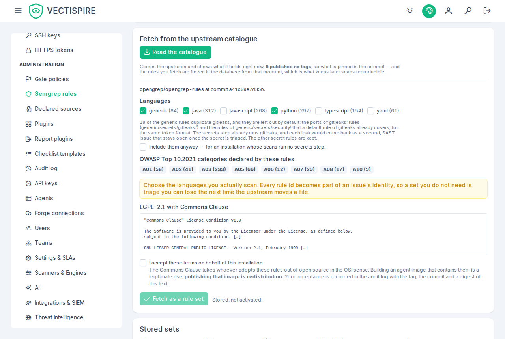
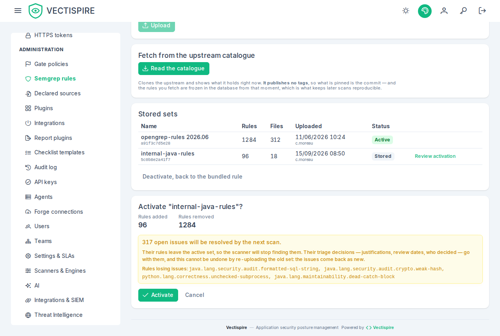

# Semgrep rule sets

Semgrep reads the source code itself — a concatenated SQL query, a command handed to a
shell, an unverified TLS certificate. No other scanner here sees any of that.

It is **off by default**, and it runs with the network disabled like every other scanner.

!!! info "Who can read, who can change"
    Reading the rule sets and their impact is open to administrators, the CISO and the **Auditor**
    role. Uploading a set, activating or deactivating one requires an administrator or the CISO.

## Why you have to install rules yourself

**Vectispire bundles a single rule.**

That is a licensing constraint, not an oversight: the public Semgrep rule sets are not
redistributable. Shipping them would put a redistribution problem into every deployment of
this product.

So real coverage comes from a rule set you install. Enabling Semgrep without one gets you
one rule's worth of findings and a false sense of coverage — which is worse than leaving it
off.

## Installing one

Obtain a rule set under a license that permits your use, and register it on **Rule sets**.
Semgrep's own registry, your organisation's internal rules, or a vendor's — the constraint
is on Vectispire redistributing them, not on you running them.

### From the upstream catalogue

**Fetch from the upstream catalogue** clones `opengrep/opengrep-rules`, shows its licence and how many
rule files each language holds, and stores the languages you choose as a set — not activated. Choose the
languages you scan: every rule id becomes part of an issue's identity.

**The rules that duplicate gitleaks are left out by default.** The secrets step runs gitleaks with its
default rules — Vectispire's gitleaks configuration extends them — and `generic` holds two groups of
rules that look for the same thing:

- `generic/secrets/gitleaks/`, some 175 rules ported from gitleaks itself;
- 27 of the 50 rules of `generic/secrets/security/`, each looking for a token format a dedicated default
  rule of gitleaks (v8.30.1, the version the secrets step runs) already finds: AWS access key ids,
  Artifactory, Facebook, GitHub, Google and Google Maps API keys, Heroku, JWTs, Mailchimp, Mailgun,
  Picatic, PGP and other private keys, SendGrid, Slack tokens and webhooks, Snyk, SonarQube, Square,
  Stripe, Telegram and Twilio, and the generic API key and generic secret rules.

Imported as well, each leaked key would be found twice: a *secret* issue and a *SAST* one, two issues
since the type is part of an issue's identity. Triaging the secret would leave its SAST twin open, where
it can still fail the gate, weigh on the score and count its OWASP category a second time. The screen
says how many it leaves out once `generic` is chosen, and **Include them anyway** brings both groups in —
for an installation whose scans run no secrets step. The other 23 rules of `generic/secrets/security/`
stay, because gitleaks' defaults do not look for what they do: a bcrypt hash, an `/etc/shadow` line, a
username and password in a URI, an AWS secret access key or session token, an `_authToken` in an
`.npmrc`, a Google OAuth access token…

A set imported before 0.11.0 with `generic` keeps those rules until you import again. Activating the
new set is then guarded like any other: their open issues are counted, by rule, before the button
goes ahead.

For a script: `POST /api/v1/rule-sets/catalogue` takes `includeGitleaksDuplicates` (`false` when
absent), and the preview's `gitleaksDuplicates` is the count it concerns, both groups together. A set
holding them is named `… with gitleaks duplicates`.

## OWASP categories {#owasp-categories}

A rule places its findings in the [OWASP grid](../guide/risk-analysis.md#attack-surface-and-owasp)
through the category it declares in its own `metadata.owasp`, and only a category of the **2021
edition** counts (`A03:2021 - Injection`) — the edition 1.0 keeps ([compliance](../guide/compliance.md#owasp-edition)).
The editions share their letters and not their meanings (`A01:2017` is Injection, `A01:2021` Broken
Access Control), so another edition is never converted.

A rule declaring no category of the 2021 edition is placed by the CWE it declares in `metadata.cwe`, by
the OWASP 2021 lists ([Risk analysis](../guide/risk-analysis.md#attack-surface-and-owasp)). A rule tagged
**only** with another edition — `A01:2025` alone, or `A1:2017` alone — and with no such CWE still runs and
its findings reach the backlog, but the grid places none of them. The rule sets screen says so: *N rule files
declare only an OWASP Top 10 edition other than 2021*, with the count per edition. Add the category of the 2021 edition
beside the other one in the rule's `metadata.owasp`.

For a script, `GET /api/v1/rule-sets/coverage` carries the same count as `owasp`: `ruleFiles` read,
`tagged` (declaring a category of the 2021 edition), `byCwe` (placed by their CWE instead), and `untagged`, one entry per reason — `ONLY_2025_EDITION`,
`ONLY_2017_EDITION`, `NOT_DECLARED` — with its `ruleFiles`. The reasons are open: a client meets one it
does not know by showing its name.

## Security and quality

Semgrep findings arrive in two kinds:

- **security** — gated like any vulnerability;
- **quality** — visible in the backlog, and they **can never fail a CI gate**.

That boundary is structural rather than configurable. See
[Code quality](../guide/quality.md).

## Rolling it out

Expect a large first result on an existing codebase. Enable it on one repository, work
through what it says, tune the rule set, and only then widen — turning it on estate-wide in
one go produces a backlog nobody triages and a feature everybody ignores.

**Activation says what it costs before it does it.** The rules a new set drops are rules whose
open issues resolve on the next scan, and their justifications, review dates and decider go with
them. Re-uploading the old set does not bring them back: the issues return as new ones.

**And it goes ahead only on that number.** When the change would resolve at least one open issue,
the **Activate** button — and **Deactivate, back to the bundled rule**, which drops the active set's rules
the same way — is refused until you confirm the count the preview shows. The count is read again
when you confirm: if findings arrived since the preview, you are shown the new number and asked
again, so a preview taken earlier never authorises more loss than it displayed. A change that
resolves nothing activates at once. The audit log records the loss you accepted, by number and by
rule. The bundled rules run beside every set, so their issues are never counted as lost.

For a script: send `acceptLosing` with the preview's `affectedIssues`; a `409` of type
`urn:vectispire:problem:rule-set-activation-loses-issues` carries the current `affectedIssues` and
`losingIssues`. See the [API reference](https://github.com/asmolabs/vectispire/blob/main/docs/en/api/rest_api_reference.md).
