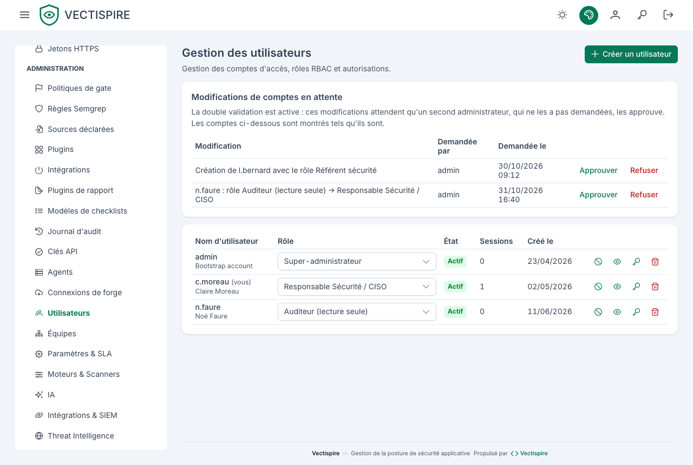
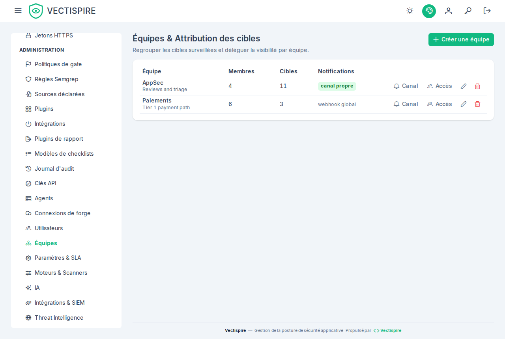

# Utilisateurs et équipes

## Comptes

Il n'y a **aucune page d'inscription**. Un administrateur crée chaque compte.

Le premier vient des variables d'amorçage au premier démarrage, et seulement quand la table des
utilisateurs est vide — voir
[Installation](../getting-started/installation.md#the-first-account). Ensuite, les deux
variables sont ignorées.

Un compte porte un indicateur `is_active`. Un compte désactivé ne peut pas se connecter, et son
historique reste intact — ce qui est tout l'intérêt de désactiver plutôt que de supprimer.

### L'obligation de changer de mot de passe

Un compte créé depuis l'écran **Utilisateurs**, un compte dont un administrateur réinitialise le mot
de passe, et le compte d'amorçage doivent changer leur mot de passe à leur prochaine connexion ;
jusque-là, toute route autre que le changement de mot de passe, le profil et la déconnexion répond
`403`. La liste les marque *Doit changer son mot de passe*.

Pour un compte que le fournisseur d'identité connecte — lié à un sujet du fournisseur, par l'annuaire
SCIM ou par une première connexion unique — l'obligation ne peut pas être remplie : son titulaire ne
connaît pas le mot de passe qu'il a reçu, et l'écran de changement demande ce mot de passe. Les comptes
que l'annuaire a créés en 0.10.0 ou en `v0.11.0-rc.1` sont dans cet état. Un administrateur la lève
par le bouton de déverrouillage de la ligne du compte, après confirmation.

- **La levée écarte le mot de passe local.** Lier un compte à un sujet du fournisseur garde le mot de
  passe qu'il avait, et la connexion par mot de passe l'accepte toujours. Lever l'obligation remplace ce
  mot de passe par un mot de passe que personne ne connaît, dans la même modification, si bien que le
  compte ne se connecte plus que par le fournisseur : un mot de passe saisi par un administrateur cesse
  de fonctionner au lieu de rester valide pour toujours. Pour redonner un mot de passe au compte, le
  réinitialiser — ce qui rétablit l'obligation.
- **Ses sessions ouvertes se ferment.** Une session retenue sur l'écran de changement a pu être ouverte
  avec ce mot de passe ; le compte se reconnecte par le fournisseur. Ses clés d'API restent : aucune n'a
  pu être émise tant que l'obligation tenait.

- **Seulement pour un compte lié au fournisseur.** Un compte qui se connecte avec son propre mot de
  passe est refusé (`400`) : l'obligation est ce qui fait qu'un mot de passe choisi par quelqu'un
  d'autre — un administrateur, la configuration d'amorçage — cesse d'être un identifiant, et le compte
  la lève en changeant ce mot de passe. Le bouton ne lui est pas proposé.
- **Jamais sur son propre compte**, et celle d'un super-administrateur par un super-administrateur
  seulement, comme pour toute autre modification de son compte.
- **Enregistrée.** Le journal d'audit nomme qui l'a levée et pour quel compte (`USER_UPDATED`), et
  l'entrée part vers le SIEM comme une modification de compte (`VECTI-SEC-010`).
- **Idempotente.** Un compte qui ne doit rien est rendu tel quel, sans modification ni entrée.

La route est `DELETE /api/v1/users/{id}/password-change-requirement`, pour les administrateurs.

### Réinitialiser un second facteur

Un compte dont le titulaire a perdu le téléphone et les codes de secours, ou qui porte un facteur que
son titulaire n'a pas enrôlé, le récupère par le bouton bouclier de sa ligne (proposé quand un facteur
est enrôlé). Retirer un facteur demande sinon un code actuel, ce qui manque justement à ce titulaire.

- **Le facteur est retiré et les sessions du compte se ferment** : un facteur enrôlé par quelqu'un
  d'autre est venu avec une session de cette personne. Le compte se connecte avec son seul mot de passe
  jusqu'à un nouvel enrôlement.
- **Ses clés d'API restent.** Si le compte a pu être compromis, réinitialisez aussi son mot de passe :
  c'est ce qui les révoque.
- **Jamais sur son propre compte**, et celui d'un super-administrateur par un super-administrateur
  seulement.
- **Enregistrée** comme `USER_UPDATED`, et envoyée au SIEM comme une modification de compte
  (`VECTI-SEC-010`).
- **Idempotente.** Un compte sans facteur est rendu tel quel, sans entrée.

La route est `DELETE /api/v1/users/{id}/second-factor`, pour les administrateurs.

### L'adresse e-mail {#the-e-mail-address}

L'adresse e-mail d'un compte est celle où sont envoyés les rappels aux contacts d'une checklist. Elle
se saisit, facultativement, dans le formulaire de création, et se définit, se change ou s'efface
ensuite depuis le bouton enveloppe de la ligne du compte (depuis 1.0.0-rc.2).

- **Contrôlée, pas vérifiée.** L'adresse doit avoir la forme `nom@example.org` — un seul `@`, un point
  dans le domaine, ni espace, ni virgule, ni autre séparateur —, compter au plus 255 caractères et
  n'appartenir à aucun autre compte, sans tenir compte de la casse ; sinon `400` avec la raison. Seul
  un rappel envoyé dit si la boîte existe.
- **Un champ vide l'efface.** Renvoyer l'adresse que le compte porte déjà ne change rien et n'écrit
  rien au journal.
- **Pas sur un compte que l'annuaire SCIM écrit.** L'annuaire remplace l'adresse à chaque
  synchronisation : une adresse saisie ici ne durerait que jusqu'à la suivante. La fenêtre l'affiche
  en lecture seule et le dit, et l'API répond `409` avec le code `managed-by-directory`. Modifiez-la
  dans l'annuaire. Un compte est marqué comme celui de l'annuaire par sa première écriture de
  provisionnement à partir de 1.0.0-rc.2 ; un compte provisionné avant l'est par la suivante.
- **Elle n'accorde rien.** Rien ne connecte ni ne lie un compte par son adresse : sous double
  validation, une adresse envoyée avec une modification qui attend l'approbation s'applique aussitôt,
  comme une activation.
- **Enregistrée** comme `USER_UPDATED` — *e-mail address set*, *changed* ou *cleared* — sans
  l'adresse elle-même, et envoyée au SIEM comme modification de compte (`VECTI-SEC-010`).

La route est `PATCH /api/v1/users/{id}` avec `email`, pour les administrateurs.

### Les modifications qui attendent un second administrateur {#changes-that-wait-for-a-second-administrator}

[Double validation](four-eyes.fr.md) activée, trois gestes qui feraient un approbateur sont **soumis
à un autre administrateur** au lieu d'être appliqués :

- créer un compte doté d'un rôle qui approuve — Champion sécurité, RSSI, Administrateur,
  Super-administrateur ;
- élever le rôle d'un compte vers l'un d'eux ;
- réinitialiser le mot de passe d'un compte qui en détient un.

L'écran indique que la modification attend, et la liste sous **Modifications de comptes en attente**
en haut de la page, avec son demandeur et sa date. Un autre administrateur l'y approuve ou la refuse ;
jusque-là, rien n'a changé sur le compte. Le demandeur peut refuser sa propre demande pour la retirer,
mais **ne peut pas l'approuver**, et personne n'approuve une modification de son propre compte.
L'approbation applique la modification comme son approbateur la ferait : un administrateur ne peut
pas approuver la création d'un super-administrateur, et une demande dont le compte a changé de rôle
entre-temps est refusée comme périmée. Le mot de passe temporaire saisi avec la demande n'est conservé
que sous forme d'empreinte jusqu'à ce que l'approbation le pose, et le compte doit le changer à sa
connexion suivante, comme après toute réinitialisation.

Activer, désactiver, attribuer des cibles et donner un rôle qui n'approuve rien — Utilisateur,
Auditeur — s'appliquent aussitôt, comme avant : retirer un privilège doit rester facile. Une
désactivation envoyée avec une modification soumise s'applique aussitôt elle aussi.

**Face à un identifiant volé** : la réinitialisation d'un compte qui approuve attend comme les autres,
donc **désactivez d'abord le compte**. La désactivation ferme ses sessions et arrête ses clés d'API
aussitôt, sans personne à attendre ; réactivez-le une fois la réinitialisation approuvée.

**Un administrateur seul n'est pas bloqué.** Sans autre administrateur — une installation dont le
seul compte est le super-administrateur d'amorçage — la modification s'applique aussitôt, et son entrée
d'audit dit qu'aucun second administrateur n'était là. Un administrateur désactivé compte toujours,
de même qu'un compte récemment sorti d'un rôle d'administration : réactivez-en ou rétablissez-en un pour
approuver. Tant qu'une modification d'un compte attend, son mot de passe ne peut pas être réinitialisé. Une demande dont le demandeur a été désactivé ou rétrogradé depuis ne
peut plus être approuvée.

**Rétablir un rôle après une réinitialisation n'appartient pas à un seul administrateur.** Une
élévation vers un rôle qui approuve est refusée (`409`, `password-known-to-administrator`) quand son
demandeur — ou, à l'approbation, son approbateur — a créé le compte ou réinitialisé son mot de passe
dans la fenêtre : abaisser un rôle, réinitialiser le mot de passe puis rétablir le rôle leur donnerait
sinon un approbateur, sans que la demande seule le montre. Un autre administrateur la dépose et
l'approuve.

L'annuaire (SCIM) peut encore accorder Champion sécurité, hors de cette file ; voir
[SSO](sso.fr.md). Et un approbateur que le demandeur a
créé, réinitialisé ou changé de rôle récemment est refusé, comme pour un triage — voir
[Double validation](four-eyes.fr.md#an-approver-the-requester-administered).

Chaque demande est inscrite comme `ACCOUNT_REQUEST_FILED`, puis `ACCOUNT_REQUEST_APPROVED` ou
`ACCOUNT_REQUEST_REJECTED`, à côté de l'entrée `USER_UPDATED` de la modification elle-même, qui nomme
les deux administrateurs. Les routes sont `GET /api/v1/account-requests`, et `POST
/api/v1/account-requests/{id}/approve` et `/reject`, pour les administrateurs ; une modification
soumise répond `202` avec la demande.

## Rôles

Les rôles décident de ce qu'une personne peut **faire** ; les équipes décident de ce qu'elle peut
**voir**. Les deux sont indépendants, et c'est voulu : donner un rôle n'élargit pas le périmètre,
sauf pour les quatre rôles qui portent explicitement une portée globale — Auditeur, CISO,
Administrateur et Super-administrateur.

| Rôle | Ce qu'il peut faire |
|---|---|
| **Utilisateur** | Voit et qualifie les constats de ses cibles. Ne peut pas approuver seul une décision qui clôt une anomalie lorsque la double validation est active. |
| **Référent sécurité** | Comme ci-dessus, et peut approuver un triage — dans le seul périmètre que ses équipes lui donnent. |
| **Auditeur** | Voit tout le parc et **ne change rien**, nulle part. Lit le journal d'audit, les preuves de conformité, la politique de barrière, les jeux de règles et la configuration SIEM. N'approuve aucun triage. |
| **Responsable Sécurité / CISO** | Voit tout le parc, approuve les triages, et **écrit** la gouvernance : barrières, jeux de règles, destination SIEM, politique de licences, réglages. N'administre pas les comptes. |
| **Administrateur** | Tout ce qui précède, plus les comptes, les équipes, les clés API, les clés SSH et les agents. |
| **Super-administrateur** | Le gouverneur de la plateforme : décide des règles sous lesquelles les autres agissent — double validation, visibilité des cibles — et administre les comptes, mais **ne prend aucune décision de triage** et n'importe aucun VEX. Créé par l'amorçage de l'installation. |

**L'auditeur mérite un mot.** Il existe parce que « regarder » et « pouvoir changer » étaient la
même permission : la seule façon d'ouvrir le journal d'audit à quelqu'un était de lui donner aussi
le droit de réécrire la politique qu'il venait vérifier. Si vous devez montrer votre posture à un
commissaire, à un client ou à un service interne, c'est ce rôle-là et pas le CISO.

Distribuez les rôles administratifs avec parcimonie : le journal d'audit n'a de sens qu'à
proportion du nombre de gens capables de changer ce qu'il enregistre.

**Seul un super-administrateur administre un super-administrateur.** Accorder ou retirer ce rôle,
réinitialiser son mot de passe, désactiver ou supprimer son compte est refusé à un administrateur.
La séparation des rôles en dépend : le compte qui peut lever la double validation est celui qui ne
peut pas trier, et un administrateur capable de se promouvoir tiendrait les deux moitiés. Pour la
même raison, **personne ne change son propre rôle**, ni vers le haut ni vers le bas — un autre
administrateur doit le faire.

## Équipes et visibilité

Les équipes décident de ce qu'une personne peut **voir**. Les cibles appartiennent à des
équipes, et chaque liste, chaque export et chaque série de tendance est restreint par la
visibilité du lecteur — la série « backlog dans le temps » du tableau de bord comprise.

Cette restriction est uniforme à dessein. Une vue qui l'ignorerait discrètement laisserait
quelqu'un déduire la forme d'un parc qu'il ne peut pas ouvrir.

## Ce qu'une attribution nomme

Une attribution — à un compte directement, ou à une équipe — nomme l'une de trois choses :

| Type | Couvre |
|---|---|
| `repository` | ce dépôt |
| `container` | cette image de conteneur |
| `project` | tous les dépôts du projet **au moment de chaque requête** — voir [Solutions et projets](solutions-and-projects.md) |

Ce qu'une personne voit est l'**union** de tout ce qui lui est attribué directement et de tout ce
qui est attribué à ses équipes. Rejoindre une équipe ne restreint jamais ce qu'on avait déjà.

**Une attribution de projet suit le projet.** Un dépôt rangé dans le projet après l'attribution est
visible de ses titulaires dès qu'il y est rangé ; un dépôt qui en sort cesse d'être visible par
cette attribution au même instant. Rien n'est réattribué, c'est tout l'intérêt — et c'est pourquoi
déplacer un dépôt d'un projet à l'autre est audité comme le changement d'accès qu'il est.

Il n'y a pas d'attribution sur une solution : attribuez chacun de ses projets. Une nouvelle
attribution nommant un projet, un dépôt ou une image inexistant — ou que l'administrateur qui
attribue ne voit pas — est refusée par un `404`, la même réponse dans les deux cas, et les
attributions du compte ou de l'équipe restent ce qu'elles étaient. Supprimer un projet, un dépôt ou
une image révoque toute attribution qui le nomme.

Les listes d'attributions d'un compte et d'une équipe montrent chaque cible par son nom — un projet
sous la forme `Solution / Projet` — et une cible supprimée depuis comme « deleted target ». Une telle
attribution est conservée quand la liste est enregistrée de nouveau, pour que la liste reste
modifiable ; retirez-la pour la révoquer. Les
fenêtres d'accès des écrans **Utilisateurs** et **Équipes** proposent chaque projet, sous la forme
*Projet — Solution / Projet*, à côté des dépôts et des images.

## Cibles sans étiquette

Une cible n'appartenant à aucune équipe n'est visible que de ceux qui voient tout. Il vaut la
peine de les chercher après un import en masse : une cible sans propriétaire est une cible dont
personne n'est responsable, et ses scans continuent de compter dans le tableau de bord de
personne.

## Voir aussi

- [Authentification unique](sso.md) — déléguer l'authentification sans déléguer l'autorisation.
- [Clés d'API](api-keys.md) — pour des machines plutôt que pour des personnes.
- [Journal d'audit](audit-log.md) — ce qui est enregistré de tout cela.
