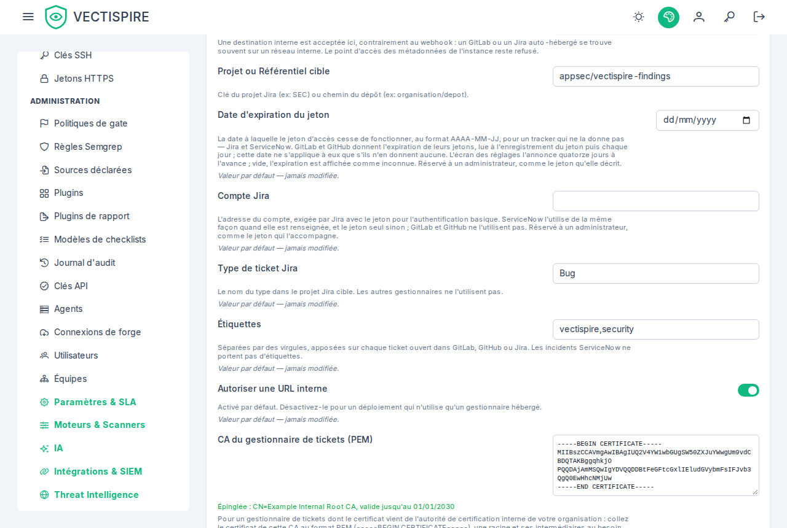
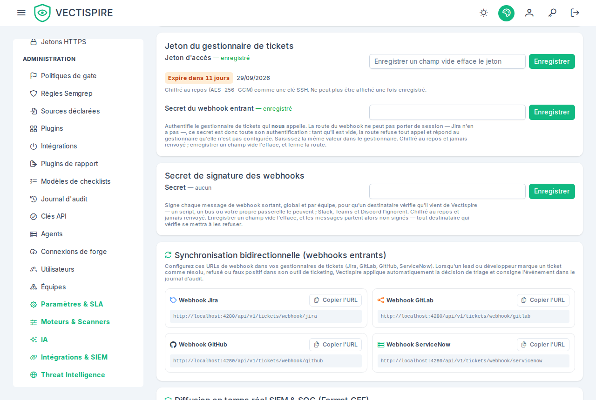

# Tickets

Vectispire ouvre des tickets dans **GitLab**, **GitHub**, **Jira** ou **ServiceNow** — un par
problème qui ferait échouer une construction.

## Un seul seuil, défini une fois

La création de tickets utilise **la même politique de barrière** que la barrière CI.

C'est la décision de conception qui vaut d'être comprise. Un seuil de ticket séparé
signifierait deux barres à tenir alignées, et elles dériveraient : les équipes finiraient avec
des tickets pour des choses qui ne font pas échouer leur construction, ou avec une construction
rouge sans ticket derrière. Une politique, une réponse. Voir
[Politiques de barrière](../administration/gate-policies.md).

## Aucun doublon, jamais

La référence du ticket est conservée **sur l'issue**.

Ainsi, une panne du tracker donne lieu à une reprise plutôt qu'à une perte, et la reprise
retrouve la référence existante sans ouvrir un second ticket. La même issue vue sur cinquante
scans nocturnes consécutifs, c'est un ticket.

Une référence attachée à la main n'est jamais écrasée : si elle arrive pendant que le balayage
ouvre un ticket pour la même issue, l'issue garde celle de la personne, et le ticket tout juste
ouvert est nommé dans le journal et dans son entrée d'audit `TICKET_CREATED` comme non
enregistré sur l'issue — il existe dans le tracker, et peut devoir y être fermé.

## Configurer

Sous [Réglages](../administration/settings.md) : le type de tracker, son URL, le projet ou la
cible, et un jeton. L'URL, le projet et le compte Jira reviennent à un administrateur, comme le
jeton : le jeton agit là où ils le dirigent. Un projet GitHub s'écrit `propriétaire/dépôt` et rien
d'autre — un chemin après lui est refusé à l'enregistrement, et de nouveau à l'envoi pour une valeur
enregistrée avant. L'URL est l'adresse seule : celle qui porte un nom d'utilisateur ou un jeton
(`https://utilisateur:…@hôte`) est refusée à l'enregistrement — le jeton a son propre champ, qui le chiffre.

Donnez au jeton la portée la plus étroite permettant de créer et de lire des tickets dans le
projet visé. Il est stocké chiffré avec votre `ENCRYPTION_KEY`, et son stockage est refusé
avant que cette clé existe. Un tracker dont le certificat vient de votre propre CA a besoin que cette
CA soit épinglée — [plus bas](#internal-ca).

## Un tracker derrière une CA interne {#internal-ca}

Un GitLab, un Jira Data Center ou un ServiceNow hébergé sur votre réseau porte souvent un certificat
émis par l'autorité de certification de votre organisation, que le magasin de confiance de
l'environnement Java ne contient pas. Avant la 0.11.0, chaque appel échouait à la négociation TLS :
aucun ticket n'était ouvert, et le balayage horaire réessayait sans le dire ailleurs que dans le
journal du serveur.

Collez le certificat de cette CA, au format PEM (`-----BEGIN CERTIFICATE-----`), dans **Réglages →
Tracker → CA du gestionnaire de tickets (PEM)** — la racine, et ses intermédiaires si votre serveur ne
les envoie pas ; jusqu'à 8 certificats et 16 384 caractères. Pour l'obtenir, demandez le certificat de
la CA émettrice à qui gère votre PKI, ou lisez la chaîne que présente le tracker —
`openssl s_client -connect gitlab.example.internal:443 -showcerts < /dev/null` — et gardez le
certificat de la CA au sommet de la chaîne, **pas** celui du serveur (le premier affiché).

- **Elle ne vaut que pour le tracker.** Chaque appel de l'intégration — ouvrir un ticket sur l'un des
  quatre trackers, le fermer, la liste des transitions de Jira, la recherche d'incident de ServiceNow
  — est vérifié avec elle ; rien d'autre de ce que Vectispire contacte ne lui fait confiance.
- **Elle remplace le magasin de l'environnement pour le tracker, elle ne s'y ajoute pas** — la même
  règle que la CA d'une [connexion de forge](../administration/forge-connections.md) et celle du
  [collecteur SIEM](siem.md#tls). Les CA publiques ne sont alors pas reconnues pour le tracker : un
  certificat qu'une CA publique aurait émis pour son nom ne passe pas. Laissez le champ vide pour un
  tracker au certificat public.
- **Le nom du tracker reste vérifié** : son certificat doit nommer l'hôte de l'URL du tracker. Il n'y
  a pas de « ne pas vérifier », qui remettrait le jeton au premier qui répond.
- **L'enregistrement refuse ce qui ne marcherait pas ou ferait trop confiance**, dans les termes des
  connexions de forge : un certificat qui n'est pas une CA (celui du serveur), une CA expirée ou pas
  encore valide, une CA dont l'usage de clé interdit de signer des certificats, tout ce qui n'est pas
  un certificat — une clé privée collée par erreur est refusée sans être recopiée dans le message.
- **Elle revient à un administrateur**, comme l'URL : elle décide à qui le jeton du tracker est
  présenté. Les autres rôles voient le champ en lecture seule et sans sa valeur. Son enregistrement
  est audité (`ticket_ca_pem changed`) et transmis au SIEM comme un changement de réglage de sécurité.
- **Affichée par son sujet et son expiration.** Passé cette date, la CA n'est plus reconnue : aucun
  ticket n'est ouvert ni fermé, le journal du serveur dit que la CA du tracker a expiré, et le remède
  est de coller la CA renouvelée.

## Quand le jeton expire, ou cesse de fonctionner {#token-expiry}

Un jeton de tracker ne dure pas : GitLab donne désormais une expiration à chaque jeton, un an au plus
par défaut. Avant la 0.11.0, le jour où il expirait, le balayage horaire échouait à chaque appel avec
une ligne du journal du serveur pour seule trace, et plus aucun ticket n'était ouvert ni fermé jusqu'à
ce que quelqu'un s'en aperçoive.

La carte du tracker sous **Réglages → Intégrations** montre désormais la vie du jeton, comme la
[liste des connexions de forge](../administration/forge-connections.md) montre celle d'une connexion :

- **Son expiration, annoncée quatorze jours à l'avance** — *Expire dans 9 jours*, puis *Expiré*. GitLab
  la donne (`GET /api/v4/personal_access_tokens/self`, pour les jetons personnels, de groupe et de
  projet) et GitHub aussi (l'en-tête `github-authentication-token-expiration` d'un appel authentifié) ;
  les deux sont interrogés à l'enregistrement du jeton puis une fois par jour, à travers la
  [CA épinglée](#internal-ca) du tracker si elle est définie. Jira et ServiceNow n'ont pas de moyen
  fiable de la dire : saisissez la date vous-même dans **Date d'expiration du jeton**
  (`ticket_token_expires_on`, `AAAA-MM-JJ`, réservé à un administrateur), qui s'applique aussi à un jeton
  GitLab ou GitHub qui n'en donne aucune. Aucune des deux connue, la carte dit *Expiration inconnue*
  plutôt que rien.
- **Qu'il a cessé de fonctionner.** Quand le tracker répond à un appel du balayage par `401` ou `403` —
  un jeton expiré, révoqué ou sans le droit nécessaire — ou à la vérification quotidienne par `401`, la
  carte dit *Ne fonctionne plus* avec le statut et depuis quand, avant toute date. La limite de débit de
  GitHub, qui répond aussi `403`, n'est pas un refus : un `403` portant `x-ratelimit-remaining: 0` ou
  `retry-after`, et tout `429`, laissent la carte telle quelle, et le balayage de l'heure suivante
  réessaie. Elle revient à la
  normale au prochain appel que le tracker accepte, ou quand un nouveau jeton est enregistré, ce qui
  oublie tout ce qu'on savait du précédent.

Chaque changement est dit **une fois** — l'entrée dans les quatorze jours, l'expiration, le refus, le
retour en service — jamais une fois par heure tant que rien ne change, et depuis la 0.11.1 il est poussé,
comme celui du jeton d'une connexion de forge :

| Le changement | Entrée d'audit | Événement SIEM | Canaux |
|---|---|---|---|
| À quatorze jours de l'expiration | `INTEGRATION_TOKEN_EXPIRING` | `VECTI-SEC-038` (4) | oui |
| Expiré, ou refusé par le tracker | `INTEGRATION_TOKEN_STOPPED` | `VECTI-SEC-039` (7) | oui |
| De nouveau en service — accepté de nouveau, ou remplacé — ou plus sur le point d'expirer | `INTEGRATION_TOKEN_RESTORED` | `VECTI-SEC-040` (2) | oui |

L'entrée nomme le tracker par sa sorte — GitLab, GitHub, Jira, ServiceNow — et non par son adresse, que
seul un administrateur lit sur l'écran des réglages (ressource `ticket_token`, sans acteur : personne ne l'a
fait) ; elle dit la date ou le statut et depuis quand — **jamais le jeton**, ni un en-tête — et part au SIEM par le
[crochet habituel](siem.md#catalogue-des-evenements) ; un SIEM au minimum d'usine (High) ne reçoit que le `039`.
Le message atteint chaque [canal de notification](notifications.md#integration-token-alerts) configuré
pour l'installation — le webhook global, Slack, Teams, Discord, le courriel — sous le même interrupteur
des adresses privées, par l'outbox. Ce qui a été dit est gardé en base : un redémarrage ne redit rien, et
de plusieurs instances une seule le dit. Un nouveau jeton est mesuré à ce qui a été dit du précédent :
remplacer un jeton refusé annonce son retour en service ; retirer le jeton ne dit rien. Le journal du
serveur garde sa ligne au niveau `WARN`. `GET /api/v1/settings/ticket-token` répond
`expiresAt`, `expirySource` (`reported`, `declared` ou `unknown`), `refusedStatus`, `refusedSince` et
`checkedAt` à côté de `configured`, et `PUT` répond de même une fois le tracker interrogé.

## Ce qui atterrit dans le ticket

De quoi agir sans ouvrir Vectispire : le composant et sa version, l'identifiant, la gravité,
l'existence d'un correctif, les statuts EPSS et KEV, et un lien de retour vers l'issue.

## Boucler la boucle

Fermer le ticket dans le tracker ne résout pas l'issue dans Vectispire — `state` n'est écrit
que par le pipeline, à partir de ce que les scanners observent. Corrigez la dépendance, et le
scan suivant la résout.

L'autre sens est automatique : quand un scan résout une issue, Vectispire ferme le ticket qu'il
avait ouvert pour elle. Chaque traqueur est appelé avec le verbe que son API route pour une mise à
jour — `PUT` sur GitLab, `PATCH` sur GitHub et ServiceNow, une transition sur Jira — celle que le workflow du ticket propose
vers un statut de catégorie *done*, demandée à Jira à chaque fois plutôt que supposée. ServiceNow
désigne un enregistrement par son `sys_id`, alors que la référence gardée par Vectispire est le
numéro d'incident que les gens lisent (`INC0012345`) : le numéro est donc d'abord recherché dans la
table des incidents, et le compte ServiceNow a besoin du droit de **lecture** sur `incident` en plus
de l'écriture.

Si elle ne va pas être corrigée, c'est une [décision de triage](../guide/issues.md) : **ne sera
pas corrigé — risque accepté**, avec une date de réexamen et sans justification VEX, puisque le
produit reste exposé.

## Le webhook entrant {#inbound-webhook}

Un tracker peut aussi rappeler Vectispire, sur `POST /api/v1/tickets/webhook/{provider}` —
`gitlab`, `github`, `jira` ou `servicenow`. Quand un ticket que Vectispire connaît par sa
référence est fermé comme non corrigé ou comme faux positif, l'appel **propose** une décision sur
l'issue ; toute autre mise à jour est seulement tracée dans le journal d'audit. Les deux fermetures
sont deux affirmations différentes, et elles sont proposées sous deux statuts différents
([décision 0041](https://github.com/asmolabs/vectispire/blob/main/docs/architecture/fr/decisions/0041-will-not-fix-is-not-not-affected.md)) :

| Le ticket est fermé comme | Statut proposé | Justification |
|---|---|---|
| un refus — Jira *Won't Fix*, *Declined*, *Rejected* ; ServiceNow *Won't Fix*, *Risk Accepted*, *Withdrawn* ; GitHub *not planned* (`state_reason: not_planned`) ; GitLab fermé avec *wontfix* ou *won't fix* dans son titre | `will_not_fix` | aucune, et une date de réexamen proposée à quatre-vingt-dix jours |
| un faux positif explicite — Jira *False Positive*, *Cannot Reproduce* ; ServiceNow *False Positive*, *Not an Issue* ; les mots *false positive* dans le corps d'une issue GitHub ou dans le titre ou la description d'une issue GitLab | `not_affected` | `vulnerable_code_not_in_execute_path` |

**Un refus n'est jamais proposé comme `not_affected`.** Il dit que l'équipe ne corrigera pas la
vulnérabilité, pas que le produit en est à l'abri ; avant la 0.11.0, il était proposé comme
`not_affected` avec `inline_mitigations_already_exist`, une atténuation dont le tracker n'avait
jamais parlé et que les documents signés auraient portée une fois la demande approuvée. Le *not
planned* de GitHub est sa seule façon de fermer sans avoir terminé, et ne dit rien de
l'atteignabilité : c'est un refus, et non plus un faux positif.

**Il est refusé tant qu'aucun secret n'est posé.** La route est la seule ouverte sans compte — le
tracker ne porte pas de session —, le secret est donc toute son authentification. Tant que
**Paramètres → Tickets → Secret du webhook entrant** est vide, chaque appel reçoit `403` et
*« The ticket webhook is not configured on this instance »*, ce que montre le journal de livraison
du tracker. Posez le secret, puis la même valeur dans le tracker, présentée comme ce tracker
présente un secret :

| Tracker | En-tête | Ce qu'il porte |
|---|---|---|
| GitLab | `X-Gitlab-Token` | le secret lui-même, le champ *Secret token* de GitLab |
| GitHub | `X-Hub-Signature-256` | `sha256=` suivi du HMAC-SHA256 du corps brut, le champ *Secret* de GitHub |
| Jira, ServiceNow | `X-Vectispire-Token` | le secret lui-même — aucun des deux n'a de convention, cet en-tête est donc accepté pour ces deux-là et aucun autre |

Un en-tête faux ou absent reçoit `401`, sans dire quel en-tête était attendu. Un secret enregistré
qu'aucune clé configurée ne déchiffre refuse de la même façon : posez-le de nouveau.

**Un refus est un document « problem »** ([RFC 9457](../reference/errors.md)), comme tout autre refus
de l'API : le `400` d'un fournisseur inconnu ou d'un corps qui n'est pas du JSON, le `401` et le `403`
ci-dessus portent leur phrase dans `detail`, en `application/problem+json`. Jusqu'à la 0.11.1, ils
revenaient dans le corps d'un succès — `matched: false` et la phrase dans `actionTaken`. Une livraison
qui a été lue — appariée, sans issue correspondante, déjà traitée — garde ce corps.

**Une livraison n'est traitée qu'une fois.** L'empreinte de chaque corps accepté est gardée trente
jours ; le même corps reçu de nouveau dans cette fenêtre — un rejeu, ou la redélivrance du tracker
lui-même — reçoit `200` *« Delivery already processed »* et ne change rien.

**Une décision est mise en file, jamais appliquée.** L'issue passe en `pending_approval` avec le
statut proposé et sa justification, et reste *en cours d'investigation* dans les documents VEX
exportés jusqu'à ce qu'une seconde personne l'approuve sous le [principe des quatre yeux](../administration/four-eyes.md).
La demande garde le statut que le tracker demandait (`triageRequestedStatus`) : l'approbateur
accorde ce statut — un *Won't Fix* comme `will_not_fix`, jamais comme `not_affected` — ou refuse la
demande, et fixe la date de réexamen, que la fenêtre propose d'après la demande.
L'auteur enregistré est l'intégration (`GITLAB_webhook`, …) ; le nom que rapporte le tracker va
dans le commentaire, comme donnée rapportée et non comme identité.

**Une décision qu'une personne a réglée ne bouge pas sur un ticket.** Sur une issue déjà
`not_affected`, `will_not_fix` ou `fixed`, la parole du tracker est inscrite au journal d'audit et
rien ne change. Quand elle contredit le statut réglé — un *Won't Fix* sur une issue déclarée non
affectée, un faux positif sur un risque accepté —, l'entrée est `TRIAGE_CONTRADICTED_BY_TRACKER`,
signalée au SIEM comme [`VECTI-SEC-037`](siem.md#catalogue-des-evenements) : l'un des deux se
trompe, et seule une personne peut dire lequel. Un tracker qui est d'accord est audité, pas
signalé.

**Un ticket peut valoir pour plusieurs issues.** Une référence attachée à plus d'un constat — un
ticket pour une CVE présente dans plusieurs dépôts — et un numéro GitLab ou GitHub enregistré avec
ou sans son `#` correspondent tous : chaque issue qui la porte est synchronisée, avec son propre
historique et sa propre entrée d'audit, et la réponse les liste dans `issueIds`, de la plus ancienne
à la plus récente (`issueId` est la première). Jusqu'à la 0.11.0, deux telles issues recevaient `500`
à chaque livraison.

Les livraisons sont limitées par adresse d'appelant (`VECTISPIRE_WEBHOOK_REQUESTS_PER_WINDOW`, voir
[Configuration](../reference/configuration.md)).
